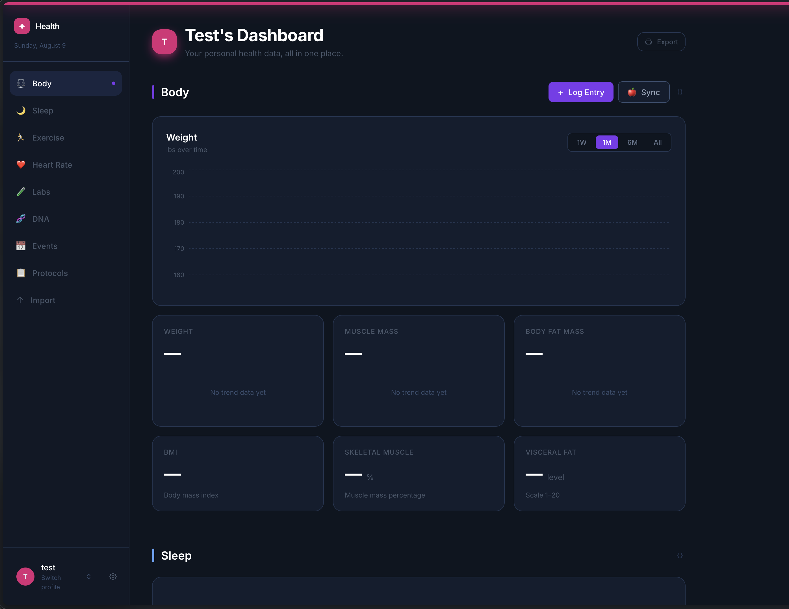
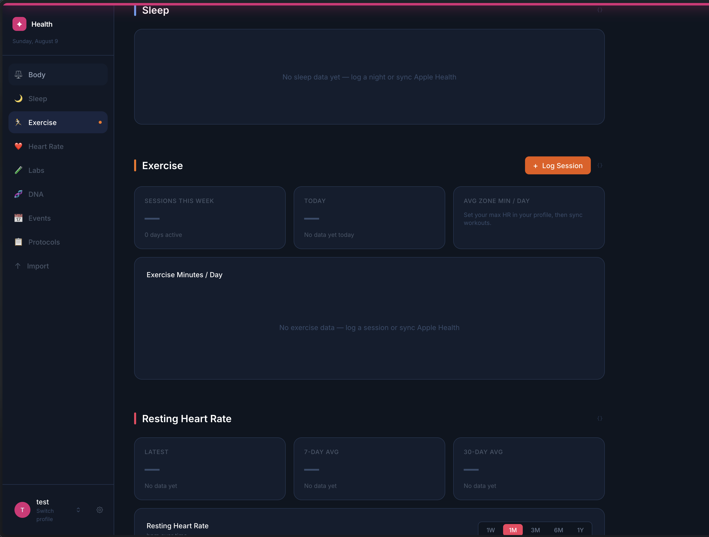
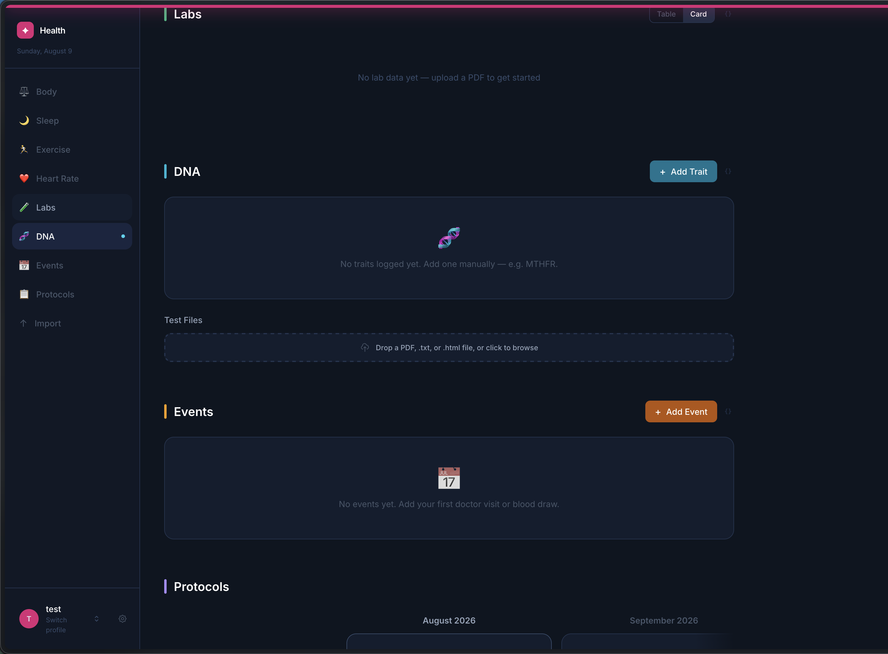
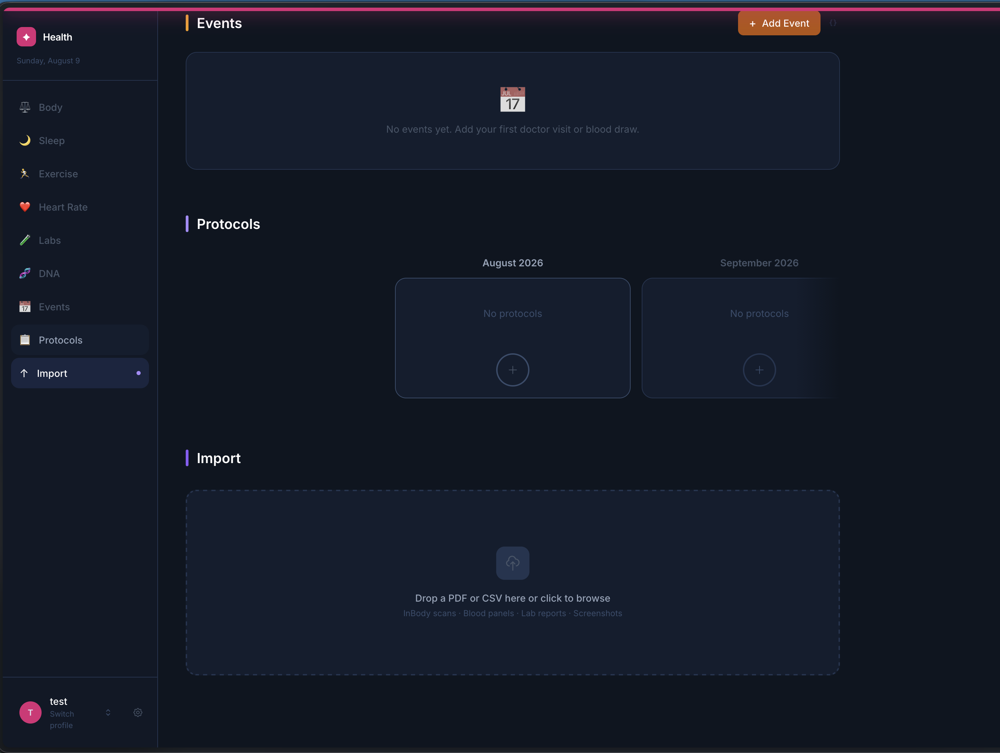
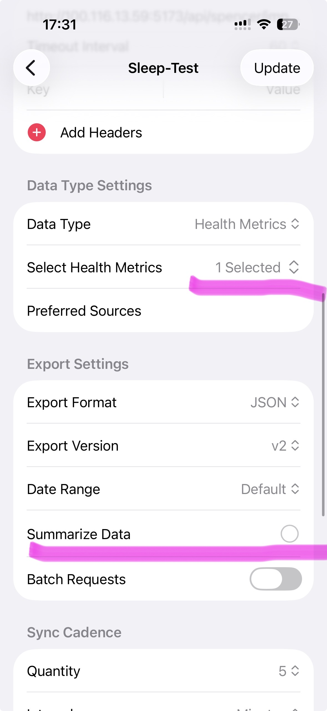
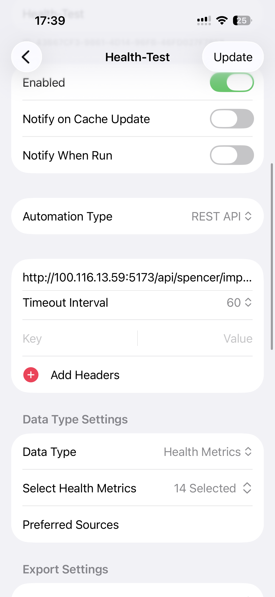
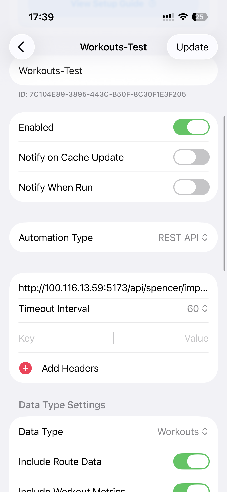
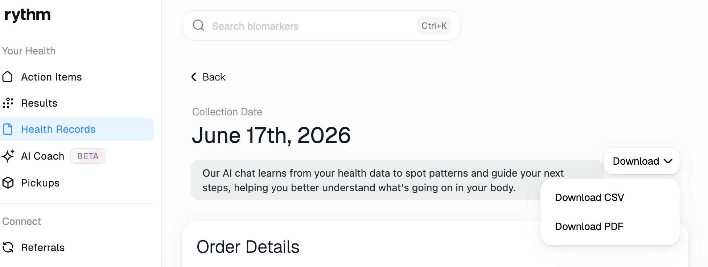

<p align="center">
  
</p>

<h1 align="center">Health</h1>

<p align="center">
  <b>One health dashboard to rule them all.</b><br>
  Bloodwork, InBody scans, smart-scale weight, sleep, exercise and Apple Health<br>
  in one self-hosted dashboard. AI OCR for PDFs and PNGs, plus a REST API.
</p>

<p align="center">
  <a href="https://github.com/spuder/health/pkgs/container/health"></a>
  <a href="#deploying-with-docker--tailscale"></a>
</p>

<p align="center">
  <a href="#features">Features</a> ·
  <a href="#screenshots">Screenshots</a> ·
  <a href="#deploying-with-docker--tailscale">Self-hosting</a> ·
  <a href="#auto-health-export">Apple Health sync</a> ·
  <a href="#import">Import</a> ·
  <a href="#mcp-server-agents">MCP</a> ·
  <a href="#development">Development</a> ·
  <a href="https://github.com/spuder/health/issues">Issues</a>
</p>

<p align="center">
  <a href="https://github.com/spuder/health/actions/workflows/ci.yml"></a>
  <a href="https://github.com/spuder/health/pkgs/container/health"></a>
  <a href="https://github.com/spuder/health/pkgs/container/health"></a>
  <a href="LICENSE"></a>
  <a href="https://github.com/spuder/health/commits/main"></a>
  <a href="https://github.com/spuder/health/issues"></a>
  <a href="https://github.com/spuder/health/stargazers"></a>
</p>

## Features

- **Import/Export** CSV or JSON.
- **Self-host** on a Raspberry Pi or any Docker host.
- **Track protocols:** supplements and medications over time.
- **Optional OCR** scanning of bloodwork.
- **REST API** to sync with external services.
- **MCP server** so AI agents can query your data and add or remove dashboard views.

## What it does

- **Ingests health data from anywhere.** Live sync from Apple Health via the [Health Auto Export](https://www.healthexportapp.com/) app, plus manual upload of PDFs, PNGs, and CSVs (lab panels, InBody scans, DNA reports). AI-powered OCR (via the Anthropic API) reads scanned lab reports and PDFs and extracts structured values automatically.
- **Tracks the full picture, not just weight.** Body composition (weight, skeletal muscle mass, body fat %), sleep (per-source, per-stage breakdown), exercise and heart-rate zones, blood/lab markers with reference ranges, DNA traits, life events, and supplement/medication protocols.
- **Multi-user.** Each family member gets their own isolated profile and database, switchable from the sidebar.
- **Self-hosted.** One Docker image, one data volume. Your data never leaves your own infrastructure.

## Screenshots

<table>
  <tr>
    <td></td>
    <td></td>
  </tr>
  <tr>
    <td></td>
    <td></td>
  </tr>
</table>

## Development

```bash
make dev
```

Installs client dependencies, starts the API server on port 3001 and the Vite dev server on port 5173 (with hot reload). Open `http://localhost:5173` in your browser, or use the mobile preview vscode extension

Run the tests with `npm test`.

## Deploying with Docker + Tailscale

The dashboard ships as a single Docker image and is designed to be reachable only over your [Tailscale](https://tailscale.com/) network: no public ports, no reverse proxy or TLS cert to manage. [`compose.yaml`](./compose.yaml) is already set up for **docktail**, a label-based sidecar that watches the Docker socket and auto-publishes containers onto your tailnet, so no manual `tailscale serve` config is needed:

```yaml
labels:
  - "docktail.service.enable=true"   # opt this container into docktail
  - "docktail.service.name=health"   # published as https://health.<your-tailnet>.ts.net
  - "docktail.service.port=3001"     # container port docktail proxies to
  - "docktail.service.service-port=443"  # port exposed on the tailnet (HTTPS)
```

1. **Run docktail** on the Docker host (once, outside this repo), pointed at the Docker socket so it can discover labeled containers.

2. **Run the dashboard:**

   ```bash
   docker compose up --build -d
   ```

   No `ports:` mapping is needed: docktail handles exposing the service on the tailnet, so the container only needs to be reachable on the Docker network. Data persists in a bind-mounted volume (`/data` in the container). Set `ANTHROPIC_API_KEY` in a `.env` file next to `compose.yaml`.

3. **Point Health Auto Export at the tailnet address** (`https://health.<your-tailnet>.ts.net`, not `localhost`) in the automations described below, so your iPhone can sync from anywhere, not just your home Wi-Fi.

Prefer a prebuilt image to `--build`? Images are published to [`ghcr.io/spuder/health`](https://github.com/spuder/health/pkgs/container/health) on every push to `main` (`latest`, `sha-<short>`) and on `v*` tags (`1.2.3`, `1.2`), for `linux/amd64` and `linux/arm64`. To use one, swap `build: .` for `image: ghcr.io/spuder/health:latest` in [`compose.yaml`](./compose.yaml).

## Getting Your User ID

Create a user in the web UI or via `GET /api/users` to list existing users. The ID is auto-generated from the user's name.

## Auto Health Export

Use [Health Auto Export](https://www.healthexportapp.com/) with **three separate automations**, all pointing at:

```
http://your-dashboard:3001/api/{userId}/import/apple-health
```

Metrics are automatically mapped to the dashboard (e.g., `body_mass` → weight).

| Sleep | Health | Workouts |
| :---: | :---: | :---: |
|  |  |  |

1. **Sleep.** Data Type: Health Metrics → select only *Sleep Analysis* → turn **Summarize Data off**.
   Sleep needs raw per-session data, not a daily summary. With Summarize Data on, HAE silently collapses every source (Apple Watch, a bed sensor, etc.) into a single point per night and picks just one, dropping the rest, even if you have multiple sources enabled under Preferred Sources. With it off, you get one row per sleep stage per source, which the dashboard reconstructs into a full per-source nightly breakdown itself.

2. **Health.** Data Type: Health Metrics → select every other metric you want tracked (weight, heart rate, labs, etc.). **Explicitly leave Sleep Analysis unchecked** here, since it's handled by the Sleep automation above. Keep Summarize Data on (default) for this one: per-session granularity isn't needed for these metrics, and turning it off can make the sync slow.

3. **Workouts.** Data Type: Workouts.

Keeping Sleep in its own automation (rather than turning off summarization for everything) avoids the slow background-sync issue HAE's own team warns about when disabling summarization across a large metric list.

## Import

You can import from CSV, PNG or PDF 

**Rythm Health**



**InBody**

Just drop the PDF/PNG/CSV into the 'import' page, AI will OCR then import values. 

## MCP server (agents)

`mcp-server.js` is a [Model Context Protocol](https://modelcontextprotocol.io/) server, so an agent (Claude Desktop, Claude Code, Cursor, or any MCP client) can query your health data and add or remove charts on the dashboard. It runs over stdio and reads the same `DATA_DIR` as the web server, so views an agent adds appear in the **Views** section (it refreshes when the tab regains focus). It does not need `ANTHROPIC_API_KEY`.

| Tool | What it does |
| --- | --- |
| `list_users` | List profiles |
| `list_metrics` | Every metric key with counts, date span, sources and latest value |
| `query_metrics` | Daily series plus min/max/avg/first/last for one or more metrics, by date range or last N days |
| `list_views` | The custom views on the dashboard |
| `get_view_data` | The data a view charts |
| `add_view` | Add a chart (`line`, `bar`, `area`, or `number`) over one or more metrics |
| `update_view` | Rename, re-scope, reorder, or star/unstar (hide) a view |
| `remove_view` | Delete a view (the metric data itself is untouched) |

Every tool takes an optional `user_id`. Set `HEALTH_USER_ID` to pick a default profile; with a single profile it is picked automatically.

Run it by hand:

```bash
DATA_DIR=./data HEALTH_USER_ID=your-user-id npm run mcp
```

**Claude Desktop / Cursor** (`claude_desktop_config.json` or `.cursor/mcp.json`), from a checkout:

```json
{
  "mcpServers": {
    "health": {
      "command": "node",
      "args": ["/path/to/health/mcp-server.js"],
      "env": { "DATA_DIR": "/path/to/health/data", "HEALTH_USER_ID": "your-user-id" }
    }
  }
}
```

**Claude Code:**

```bash
claude mcp add health --env DATA_DIR=/path/to/health/data --env HEALTH_USER_ID=your-user-id -- node /path/to/health/mcp-server.js
```

**Against the Docker deployment**, run it inside the running container so it shares the `/data` volume:

```json
{
  "mcpServers": {
    "health": {
      "command": "docker",
      "args": ["exec", "-i", "-e", "HEALTH_USER_ID=your-user-id", "health", "node", "mcp-server.js"]
    }
  }
}
```

(`health` is the container name; use `docker compose ps` to find yours.) Then ask things like *"How has my resting heart rate trended over the last 90 days?"* or *"Add a view of my outdoor running pace, and remove it when I stop running."*

The same views are available over REST: `GET/POST /api/{userId}/views`, `GET/PATCH/DELETE /api/{userId}/views/{id-or-slug}`, `GET /api/{userId}/views/{id-or-slug}/data`, plus `GET /api/{userId}/metrics` and `GET /api/{userId}/metrics/query?metric=weight&days=30`.

## Related

https://github.com/nixfred/apple-health-dashboard
